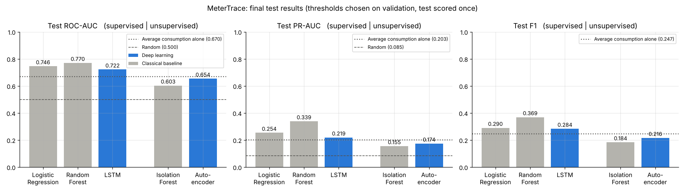
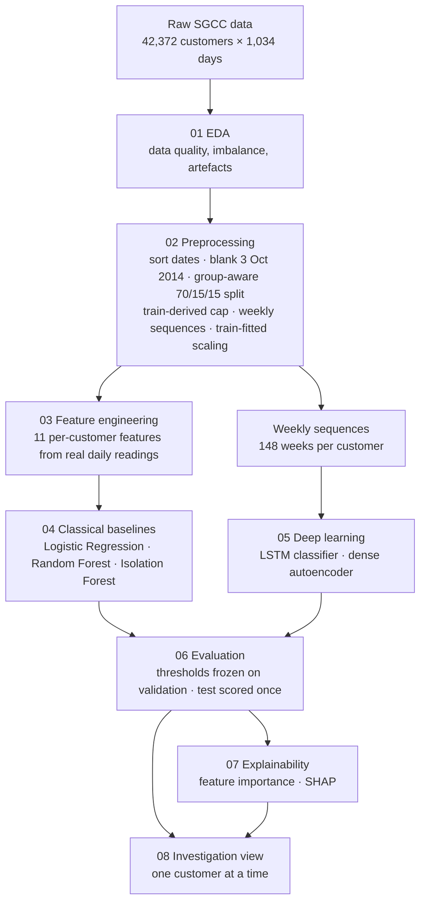
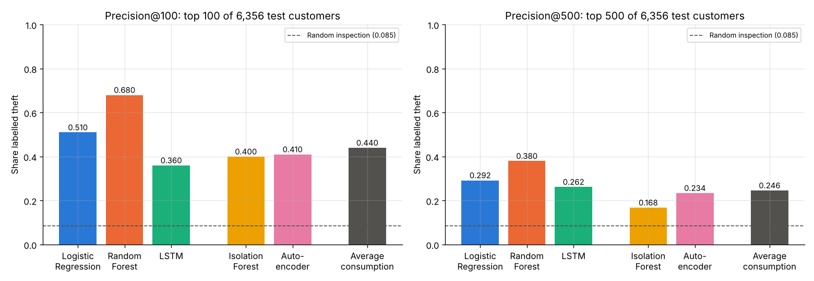
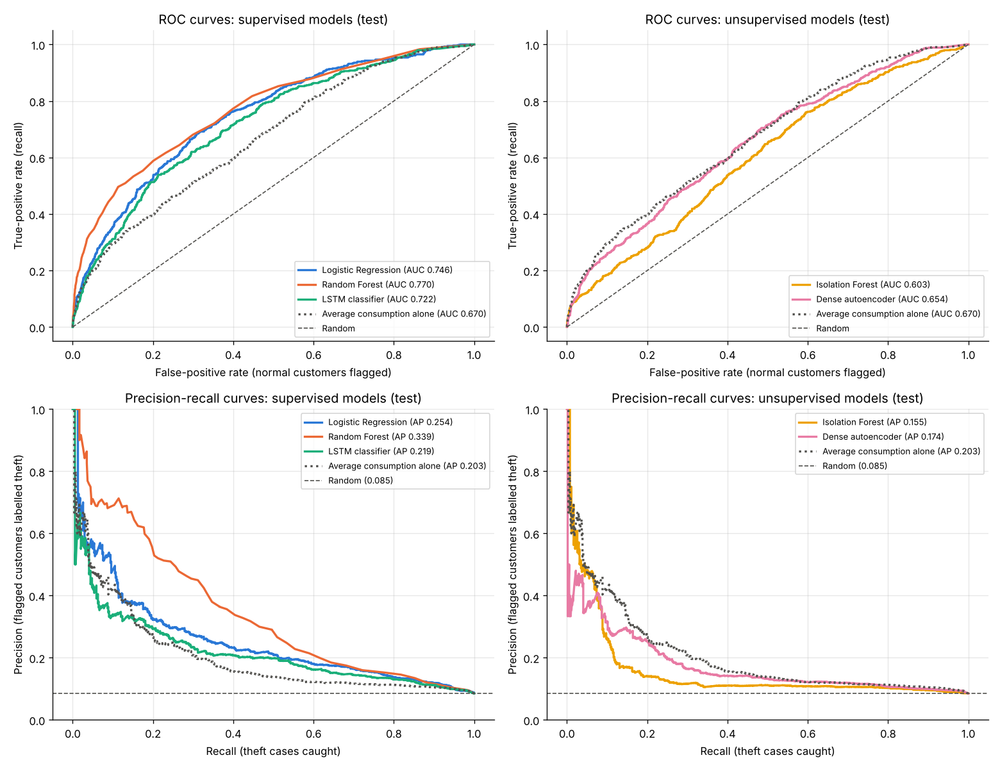
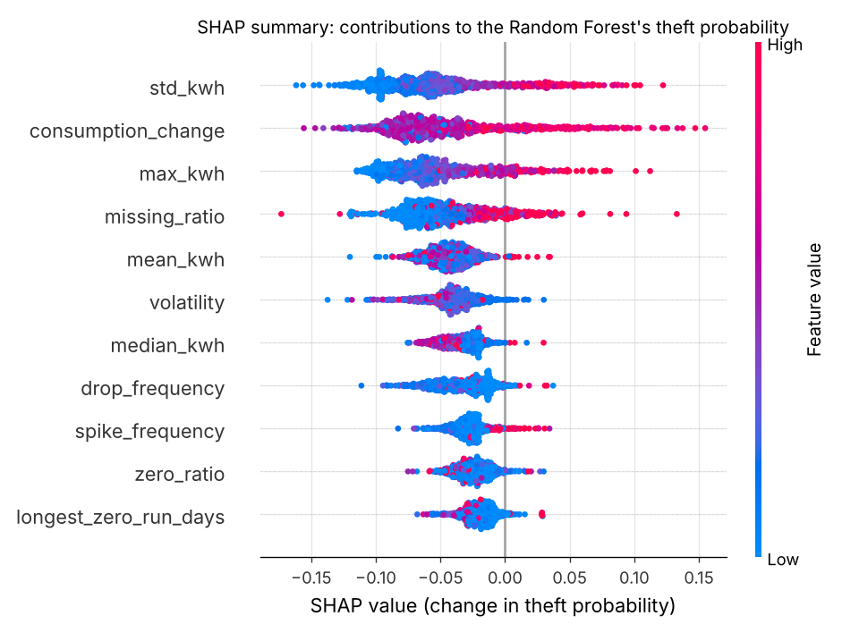
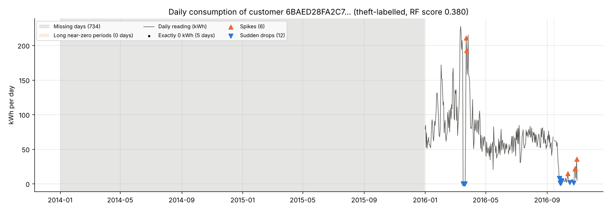
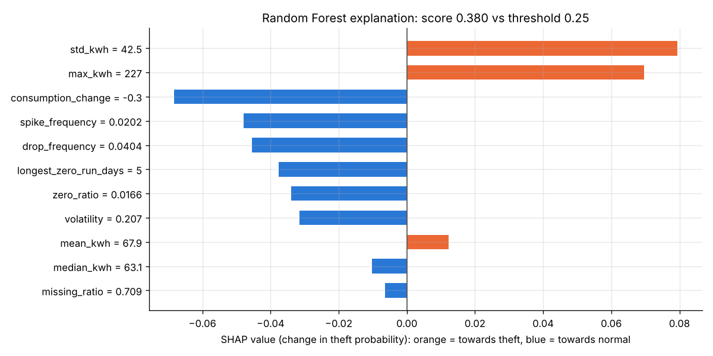
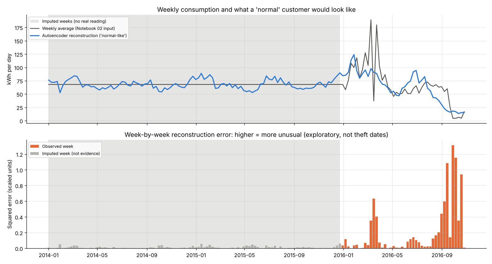

# MeterTrace

**Electricity Theft Detection and Consumption Anomaly Analysis**

MeterTrace ranks electricity customers by how closely their smart-meter readings resemble those of
customers labelled as electricity theft, so that a utility can decide **whom to inspect first**. It
compares five models on the real SGCC smart-meter dataset:
- three classical baselines;
- an LSTM classifier;
- a dense autoencoder.

It evaluates them once on held-out customers, explains the best model's decisions, and ends with a
notebook-based investigation view for individual customers.

> **Responsible use.** A high score is an **investigation lead, not proof of theft**. The labels come from
> one utility, are given per customer without dates, and their labelling process is undocumented.
> Unusual consumption also has innocent causes: businesses, new appliances, vacancies and faulty meters.
> Every flag must be checked by a human.

*The repository keeps its original working name (`IntelliGrid-Electricity-Detection`). The official project
name is MeterTrace.*

---

## Results at a glance

Final results on **6,356 held-out test customers** (542 labelled theft). The test set was scored **once**,
using thresholds chosen on validation customers beforehand.

- **Best model: Random Forest on 11 engineered features.**
  - ROC-AUC **0.7702**, PR-AUC **0.3389**.
  - **68 of its 100 highest-ranked test customers are labelled theft** (Precision@100 = 0.68). A random
    choice of 100 customers would contain about 8 or 9 (theft share 8.53%).
- **Deep learning, reported honestly:**
  - The **dense autoencoder beats Isolation Forest**, its classical unsupervised counterpart.
  - The **LSTM does not beat** the feature-based supervised models.
- **A simple, no-training reference** (ranking customers by average consumption) is a strong baseline. It
  beats both unsupervised models.



---

## Contents
- [The problem](#the-problem)
- [Dataset](#dataset)
- [Workflow](#workflow)
- [The eight notebooks](#the-eight-notebooks)
- [The five models](#the-five-models)
- [Final test results](#final-test-results)
- [What the best model learned](#what-the-best-model-learned)
- [Investigation view](#investigation-view-notebook-08)
- [Key findings](#key-findings)
- [Limitations](#limitations)
- [Getting started](#getting-started)
- [Repository structure](#repository-structure)
- [Why data and models are not on GitHub](#why-data-and-models-are-not-on-github)
- [Reproducibility](#reproducibility)
- [Project documents and citation](#project-documents-and-citation)

---

## The problem
Electricity theft includes meter tampering, bypassed meters and illegal connections. It is a major source
of **non-technical loss** for utilities. Inspecting every home is impossible, so a utility needs a
**ranked list** of accounts worth a visit. Smart meters make this possible, because every customer's daily
consumption is recorded.

MeterTrace treats this as two complementary questions:
1. **Supervised:** which customers look like those already labelled as theft? (Logistic Regression, Random
   Forest, LSTM)
2. **Unsupervised:** which customers look unlike normal customers? (Isolation Forest, dense autoencoder)

Because only 8.5% of customers are labelled theft, **accuracy is misleading**: predicting "normal" for
everyone already scores 91.5%. MeterTrace therefore reports:
- precision, recall and F1;
- ROC-AUC and PR-AUC;
- the false-positive rate;
- **Precision@100 / @500**, the share of theft among the customers an inspector would visit first.

---

## Dataset
**SGCC electricity theft dataset** (State Grid Corporation of China), released by the authors of:

> Z. Zheng, Y. Yang, X. Niu, H.-N. Dai and Y. Zhou, "Wide and Deep Convolutional Neural Networks for
> Electricity-Theft Detection to Secure Smart Grids," *IEEE Transactions on Industrial Informatics*,
> vol. 14, no. 4, pp. 1606–1615, April 2018. doi: [10.1109/TII.2017.2785963](https://doi.org/10.1109/TII.2017.2785963)

- **Source:** <https://github.com/henryRDlab/ElectricityTheftDetection> (commit `8db682e`). The data is
  distributed as a split ZIP archive (`data.zip`, `data.z01`, `data.z02`) containing a single file,
  `data.csv`.
- **Licence:** that repository contains **no licence file**. Its README asks users to cite the paper above.
  We use the data for academic purposes with that citation.
- **File checked:** `data.csv`, 175,194,613 bytes, SHA-256
  `99f8fd315626b1f729a9a03a97cb52ed097ab4d43e5771e21554c9e0c369b9b7`.
- **Columns:** `CONS_NO` (customer ID), `FLAG` (1 = theft, 0 = normal), then 1,034 daily consumption
  columns in kWh, named like `2014/1/1`.

| Property | Value (verified in Notebook 01) |
|---|---|
| Customers | 42,372 (one row each, no duplicate IDs) |
| Labels | 3,615 theft (8.53%), 38,757 normal |
| Period | 1 Jan 2014 – 31 Oct 2016: 1,034 daily columns (18 Sep 2016 absent) |
| Missing readings | 25.64% overall (31.47% for theft, 25.10% for normal customers) |

**Data issues found and handled:**
- **Column order:** the date columns are stored in text order (`2014/1/1, 2014/1/10, …`), so they had to be
  sorted.
- **Row order:** all theft customers come first in the file, so any split had to be shuffled.
- **3 Oct 2014:** the median reading jumps to 144 kWh that day. Notebook 01 found that only **15 customers**
  have a reading that day, **all labelled theft**, so it is a label-leak artefact rather than a
  system-wide spike. The day is blanked for everyone.
- **Extreme readings:** up to 800,003 kWh in a single day. They are capped at a threshold learned from
  training customers.
- **No readings:** 5 customers have no readings at all.
- **Identical histories:** 1,014 customers share an identical reading history with at least one other
  customer, and 5 of these groups have contradictory labels. They are kept, and each group stays inside one
  split.

---

## Workflow



**Leakage safeguards:**
- Customers are split **before** anything is fitted.
- Caps, scalers and thresholds are fitted on training or validation customers only.
- Identical histories never cross splits.
- The test set is used **exactly once**, in Notebook 06.

---

## The eight notebooks
All code lives in sequential Jupyter cells, without custom functions, lambdas or classes. This keeps every
step readable for an undergraduate audience. Run the notebooks **in order**; each one saves what the next
needs.

| # | Notebook | What it does |
|---|---|---|
| 01 | [`01_Data_Understanding_EDA`](notebooks/01_Data_Understanding_EDA.ipynb) | Loads the raw data and checks it against the proposal. Profiles missing values, zeros, extreme readings, the 3 Oct 2014 artefact, identical histories, trends, and an exploratory average-consumption baseline |
| 02 | [`02_Data_Preprocessing`](notebooks/02_Data_Preprocessing.ipynb) | Sorts dates and blanks the artefact day, then records missingness. Makes a group-aware stratified 70/15/15 split, a training-derived outlier cap, 148-week sequences with per-customer imputation, and training-fitted scaling |
| 03 | [`03_Feature_Engineering`](notebooks/03_Feature_Engineering.ipynb) | Computes 11 explainable features per customer from real (not imputed) daily readings |
| 04 | [`04_Machine_Learning_Baselines`](notebooks/04_Machine_Learning_Baselines.ipynb) | Trains Logistic Regression, Random Forest and Isolation Forest. Validation metrics only |
| 05 | [`05_Deep_Learning_Models`](notebooks/05_Deep_Learning_Models.ipynb) | Trains the LSTM classifier and the dense autoencoder (normal customers only). Validation metrics only |
| 06 | [`06_Model_Evaluation`](notebooks/06_Model_Evaluation.ipynb) | Chooses one threshold per model on validation (maximum F1) and freezes it, then scores the test set once with all metrics and figures |
| 07 | [`07_Model_Explainability`](notebooks/07_Model_Explainability.ipynb) | Random Forest feature importance, SHAP summary, and three individual explanations |
| 08 | [`08_Interactive_Customer_Investigation`](notebooks/08_Interactive_Customer_Investigation.ipynb) | Investigation view for one test customer: history, scores, SHAP and unusual weeks |

Every notebook ends with a **"What We Learned"** section.

---

## The five models

| Model | Branch | Input | Key settings |
|---|---|---|---|
| Logistic Regression | Supervised, classical | 11 features | `StandardScaler` + `class_weight="balanced"` |
| Random Forest | Supervised, classical | 11 features | 100 trees, `class_weight="balanced_subsample"` |
| LSTM classifier | Supervised, deep | 148 weekly values | LSTM(32) → Dropout(0.2) → Dense(1, sigmoid), class weights, early stopping |
| Isolation Forest | Unsupervised, classical | 11 features | 100 trees, fitted on normal training customers |
| Dense autoencoder | Unsupervised, deep | 148 weekly values | 148 → 64 → **16** → 64 → 148, fitted on normal training customers; score = reconstruction error |

There was no hyperparameter search; all random seeds are fixed (42). The customer split is:

| Split | Customers | Theft | Theft share |
|---|---|---|---|
| Train | 29,657 | 2,530 | 8.53% |
| Validation | 6,354 | 540 | 8.50% |
| Test | 6,356 | 542 | 8.53% |
| Excluded (no readings) | 5 | 3 | — |

---

## Final test results
These come from [`outputs/results/06_test_metrics.csv`](outputs/results/06_test_metrics.csv). Thresholds were
chosen on validation customers (maximum F1) and frozen in
[`06_validation_thresholds.csv`](outputs/results/06_validation_thresholds.csv) before any test score was
computed.

| Model | Branch | ROC-AUC | PR-AUC | Precision | Recall | F1 | False-positive rate | Precision@100 | Precision@500 |
|---|---|---|---|---|---|---|---|---|---|
| Logistic Regression | Supervised | 0.7456 | 0.2539 | 0.2259 | 0.4059 | 0.2902 | 0.1297 | 0.51 | 0.292 |
| **Random Forest** | Supervised | **0.7702** | **0.3389** | **0.4245** | 0.3266 | **0.3691** | **0.0413** | **0.68** | **0.380** |
| LSTM classifier | Supervised | 0.7216 | 0.2189 | 0.2003 | 0.4852 | 0.2836 | 0.1806 | 0.36 | 0.262 |
| Isolation Forest | Unsupervised | 0.6031 | 0.1549 | 0.1103 | 0.5498 | 0.1837 | 0.4135 | 0.40 | 0.168 |
| Dense autoencoder | Unsupervised | 0.6540 | 0.1740 | 0.1721 | 0.2897 | 0.2160 | 0.1299 | 0.41 | 0.234 |
| *Average consumption alone* | *Reference* | *0.6695* | *0.2033* | *0.2358* | *0.2601* | *0.2474* | *0.0786* | *0.44* | *0.246* |

A random ranking scores ROC-AUC 0.5 and PR-AUC ≈ Precision@k ≈ 0.085 (the theft share).

| Inspection budget: top 100 / top 500 test customers | ROC and precision-recall curves |
|---|---|
|  |  |

**The catch-vs-false-alarm trade-off.** At its threshold, Random Forest flags 417 test customers: it catches
177 of the 542 theft cases and raises 240 false alarms. The LSTM catches more theft (263) but raises 1,050
false alarms. How many false alarms are acceptable depends on the utility's inspection budget.

---

## What the best model learned
Random Forest's top five features agree between its built-in importance and SHAP:
- `std_kwh` (variability of daily consumption);
- `max_kwh`;
- `consumption_change` (rise or fall between the earlier and later half of the history);
- `missing_ratio`;
- `mean_kwh`.

Large, variable and rising consumption pushes the theft probability **up**. In this dataset the theft label
goes with *higher* recorded consumption. This is an association, not a cause.



Notebook 07 also explains three typical test customers: a correctly flagged one, a false alarm (a large
legitimate consumer) and a missed case (a long near-zero period that the features captured only partly).

---

## Investigation view (Notebook 08)
For any held-out test customer, chosen from a dropdown or by ID, the notebook shows:
- a summary with the frozen threshold;
- the **daily history**, with missing days kept separate from real zero readings, plus spikes, drops and
  long near-zero periods;
- a **SHAP explanation** of the Random Forest score;
- the **saved scores of all five models**;
- the **autoencoder's week-by-week reconstruction error**, with imputed weeks marked.

The widgets only hold the selection, and the cells below read it when they are run. So the view works
without callback functions. A 3–5 minute demo script is at the top of the notebook.

| Daily history (correctly flagged example) | Why the Random Forest flagged it |
|---|---|
|  |  |



*High-error weeks are **unusual periods**, not confirmed theft dates. Grey weeks were imputed and are not
evidence.*

---

## Key findings
1. **Engineered features plus Random Forest work best** (test ROC-AUC 0.7702, Precision@100 0.68). They
   summarise real **daily** readings, combined non-linearly.
2. **Deep learning:**
   - The autoencoder beat Isolation Forest (ROC-AUC 0.6540 vs 0.6031).
   - The LSTM (0.7216) did not beat Logistic Regression (0.7456) or Random Forest. It sees only smoothed,
     partly imputed **weekly** averages.
3. **A simple reference is hard to beat.** Average consumption alone (0.6695) outperformed both
   unsupervised models.
4. **Validation and test results agree closely.** For example, Random Forest scores 0.7628 on validation
   and 0.7702 on test, so the protocol did not overfit the validation set.
5. **Data quality matters more than model choice.** The 3 Oct 2014 artefact (15 readings, all
   theft-labelled) would have leaked the label if it had not been found and blanked.

## Limitations
- **Labels:** labels are per customer, with no theft date and an undocumented labelling process. There are
  also 5 identical-history groups with contradictory labels (91 such customers in the test set).
- **One dataset:** one utility, one region and one period. The results may not transfer elsewhere.
- **Missing readings:** missingness is informative here (late meter installation), but it is not tampering
  in itself.
- **No tuning:** the deep models are deliberately small and untuned, as agreed for an undergraduate project.
- **Explanations:** SHAP and feature importance explain the model, not the customer's behaviour, and
  correlated features share credit.

---

## Getting started
### Requirements
- **Python 3.13** (the version we tested; see [Reproducibility](#reproducibility)).
- About 2 GB of free disk space for packages, the dataset and the processed files.
- A CPU is enough, and no GPU is needed. The whole pipeline ran in about 7 minutes on a 4-core machine.
- Exact package versions are in [`requirements.txt`](requirements.txt):

| Package | Version |
|---|---|
| pandas | 3.1.0 |
| numpy | 2.5.4 |
| pyarrow | 26.0.0 |
| matplotlib | 3.11.2 |
| scikit-learn | 1.9.1 |
| joblib | 1.6.0 |
| tensorflow (includes Keras 3) | 2.21.0 |
| shap | 0.54.1 |
| ipywidgets | 8.1.9 |
| notebook | any recent version (not pinned yet) |

### 1. Clone the repository and install the packages
```bash
git clone https://github.com/STC-Dev24/IntelliGrid-Electricity-Detection.git
```
```bash
cd IntelliGrid-Electricity-Detection
```
```bash
python3.13 -m venv .venv
```
```bash
source .venv/bin/activate
```
```bash
pip install -r requirements.txt
```
On Windows, activate the environment with `.venv\Scripts\activate` instead of `source .venv/bin/activate`.

### 2. Download the dataset into `data/raw/`
Download the three parts of the split archive from the dataset authors' repository:
```bash
mkdir -p data/raw data/download
```
```bash
curl -L -o data/download/data.z01 https://raw.githubusercontent.com/henryRDlab/ElectricityTheftDetection/master/data.z01
```
```bash
curl -L -o data/download/data.z02 https://raw.githubusercontent.com/henryRDlab/ElectricityTheftDetection/master/data.z02
```
```bash
curl -L -o data/download/data.zip https://raw.githubusercontent.com/henryRDlab/ElectricityTheftDetection/master/data.zip
```
(Alternatively: `git clone https://github.com/henryRDlab/ElectricityTheftDetection.git` and copy the three
files into `data/download/`.)

### 3. Extract `data.csv`
On our Linux machine, the usual tools **failed** on this split archive (`unzip`, `zip -s 0` and
`zip -FF`). The short Python snippet below joins the three parts and decompresses the single file. It uses
only the Python standard library and checks the archive's built-in CRC checksum. Run it from the repository
root, by pasting it into `python` or a notebook cell:

```python
import struct, zlib
parts = [open(f"data/download/{name}", "rb").read() for name in ["data.z01", "data.z02", "data.zip"]]
archive = b"".join(parts)[4:]                        # remove the 4-byte split-archive marker
name_length, extra_length = struct.unpack("<HH", archive[26:30])
central_directory = archive.rfind(b"PK\x01\x02")
crc, compressed_size, file_size = struct.unpack("<III", archive[central_directory + 16:central_directory + 28])
start = 30 + name_length + extra_length
data = zlib.decompress(archive[start:start + compressed_size], -15)
assert len(data) == file_size and zlib.crc32(data) == crc, "archive is damaged: download it again"
open("data/raw/data.csv", "wb").write(data)
print("data/raw/data.csv written:", len(data), "bytes")
```

Optionally, check the file against the checksum we verified. It should print
`99f8fd315626b1f729a9a03a97cb52ed097ab4d43e5771e21554c9e0c369b9b7`:
```bash
python -c "import hashlib; print(hashlib.sha256(open('data/raw/data.csv','rb').read()).hexdigest())"
```
The `data/download/` folder can be deleted afterwards.

### 4. Run the notebooks in order
Interactively:
```bash
jupyter notebook notebooks/
```
Run `01` to `08` in order (*Run All* in each). Alternatively, run them all without opening Jupyter, from
the repository root:
```bash
for nb in notebooks/0*.ipynb; do jupyter nbconvert --to notebook --execute --inplace --ExecutePreprocessor.timeout=1800 "$nb" || break; done
```
Notebook 02 creates `data/processed/`, Notebooks 04–05 create `models/`, and all notebooks write their
tables and figures to `outputs/`. The notebooks find these folders whether they are started from
`notebooks/` or from the repository root.

### Running on Google Colab
We have **not** tested MeterTrace on Colab ourselves, so treat these steps as a guide:
1. Open a new Colab notebook.
2. Clone the repository: `!git clone https://github.com/STC-Dev24/IntelliGrid-Electricity-Detection.git`
3. Move into it: `%cd IntelliGrid-Electricity-Detection`
4. Install the tested versions with `!pip install -r requirements.txt`, then restart the session when Colab
   asks.
5. Run steps 2 and 3 above in cells (prefix the shell commands with `!`).
6. Open and run the notebooks in order from the `notebooks/` folder. Change into it first, because the
   notebooks locate the project from their working directory.

Colab's preinstalled versions (for example pandas 2.x) differ from ours. Notebook 01 was additionally run
with pandas 2.2 and gave identical results, but the other notebooks were only run with the pinned versions.

---

## Repository structure
```
IntelliGrid-Electricity-Detection/
├── README.md                  ← this file
├── MeterTrace.pdf             ← official project proposal
├── IntelliGrid Electricity Theft and Anomaly Detection (1).pdf   ← earlier report (old working name)
├── CLAUDE.md                  ← development rules, decisions log and project status
├── requirements.txt
├── notebooks/                 ← 01–08, executed, with outputs
├── outputs/
│   ├── figures/               ← all figures shown in the notebooks (01_* … 08_*)
│   └── results/               ← metric tables, scores, thresholds, parameters (CSV / JSON)
├── data/                      ← NOT in Git
│   ├── raw/data.csv           ← downloaded in step 2–3
│   └── processed/             ← created by Notebooks 02–03
└── models/                    ← NOT in Git, created by Notebooks 04–05
```

## Why data and models are not on GitHub
- **Size:** the raw dataset is 167 MB (GitHub rejects files over 100 MB), and the processed files are
  about 100 MB.
- **Ownership:** the data belongs to its original publishers, so we link to their source rather than
  redistributing it.
- **Models can be recreated:** the trained models (about 11 MB) are recreated exactly by re-running
  Notebooks 04 and 05, because all seeds are fixed.

All of these paths are listed in [`.gitignore`](.gitignore). The small result tables in `outputs/results/`
**are** committed, so every reported number can be checked without re-running anything.

---

## Reproducibility
*A fresh-clone reproduction test is in progress; this section will report exactly what was rerun.*

---

## Project documents and citation
- [`MeterTrace.pdf`](MeterTrace.pdf): the official project proposal (scope, models, evaluation plan).
- [`IntelliGrid Electricity Theft and Anomaly Detection (1).pdf`](<IntelliGrid Electricity Theft and Anomaly Detection (1).pdf>):
  the earlier report under the old working name (same scope).
- [`CLAUDE.md`](CLAUDE.md): development rules, every approved design decision (D1–D20) and the project
  status log.

If you use the dataset, please cite Zheng et al. (2018), shown in [Dataset](#dataset).
